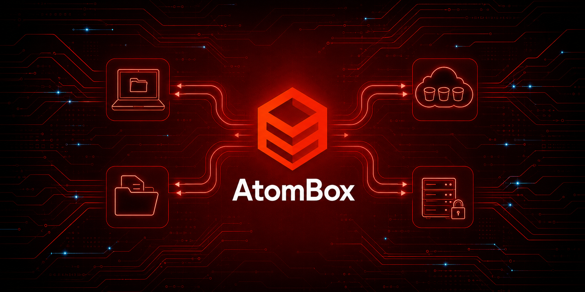
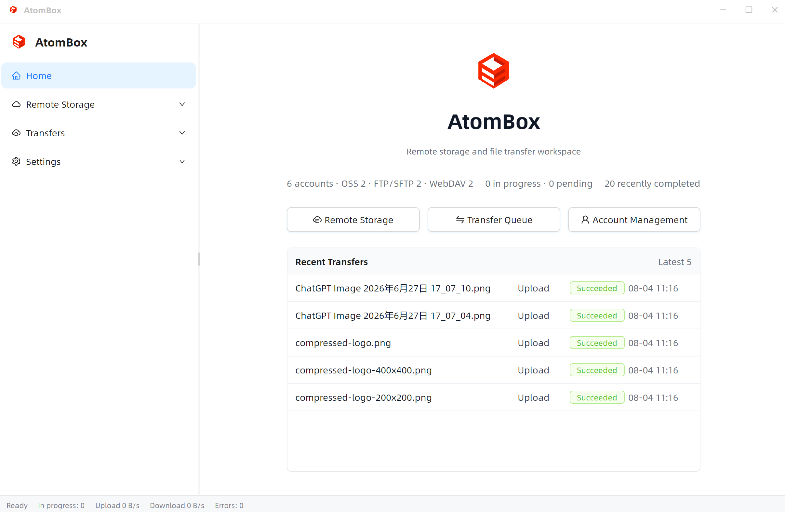
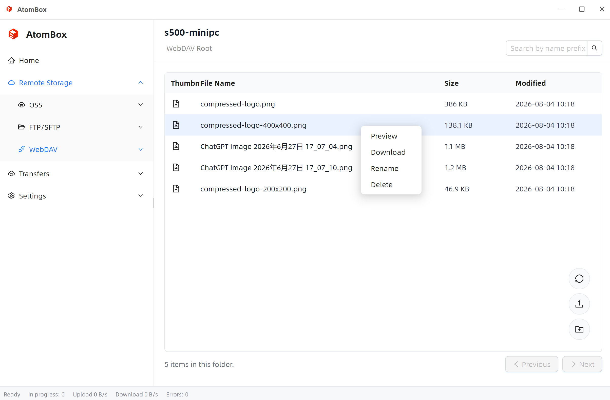
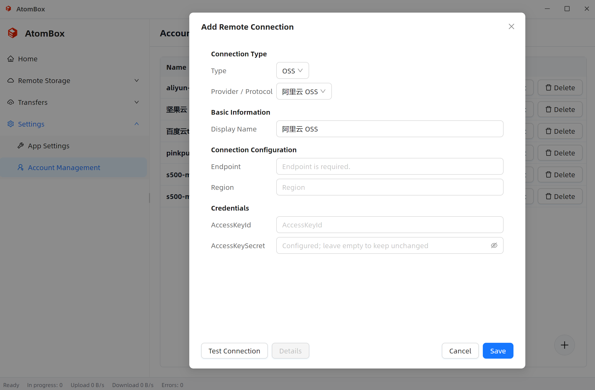
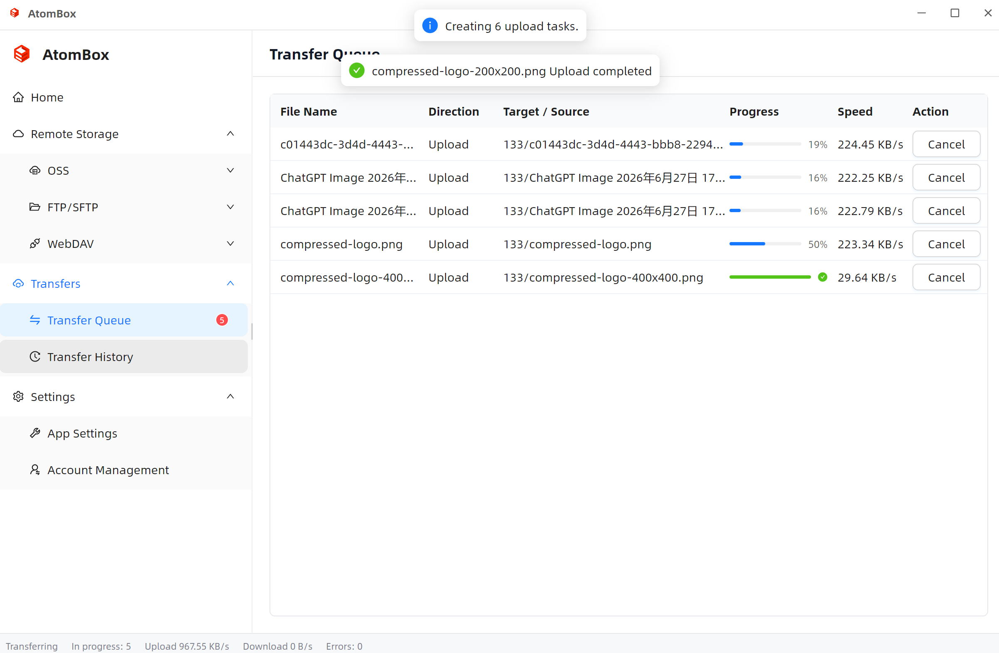

# AtomBox

English | [简体中文](./README.zh-CN.md)

[](https://github.com/ChengLab/AtomUI)


AtomBox is a desktop application for remote storage management and file transfers.

Built with AtomUI, it brings OSS, FTP/SFTP, WebDAV, and other remote storage services into one interface. You can add accounts, browse remote files, upload and download files, and monitor transfer queues and history.



## Feature Overview

AtomBox organizes its main features in the navigation menu:

```text
AtomBox
├─ Home
├─ Remote Storage
│  ├─ OSS
│  ├─ FTP/SFTP
│  └─ WebDAV
├─ Transfers
│  ├─ Transfer Queue
│  └─ History
└─ Settings
   ├─ Application Settings
   └─ Account Management
```

## Home

The Home page provides a quick overview of the current AtomBox status.

It shows:

- The number of configured accounts.
- Account counts by type, including OSS, FTP/SFTP, and WebDAV.
- The numbers of running, pending, and recently completed transfer tasks.
- Recent transfer records.
- Quick access to remote storage, the transfer queue, and account management.



## Remote Storage

Remote Storage is the main workspace in AtomBox.

Currently supported storage types include:

- OSS object storage.
- FTP/SFTP file services.
- WebDAV file services.

From the Remote Storage page, you can:

- Browse buckets or remote directories.
- Open folders.
- Navigate back to parent directories with the path bar.
- Search OSS objects by name prefix.
- Upload files.
- Create folders.
- Refresh the current directory.
- Download, rename, and delete files.
- Open, rename, and delete folders, subject to the capabilities of each provider.



### OSS

OSS accounts connect AtomBox to object storage services.

Integrated or supported object storage providers include:

- Alibaba Cloud OSS
- Tencent Cloud COS
- Qiniu Kodo
- Upyun USS
- Huawei Cloud OBS
- Baidu AI Cloud BOS
- JD Cloud OSS
- QingCloud QingStor
- Volcano Engine TOS

Alibaba Cloud OSS, Tencent Cloud COS, Qiniu Kodo, Upyun USS, Huawei Cloud OBS, Baidu AI Cloud BOS, and Volcano Engine TOS are the primary supported paths in the current release. JD Cloud OSS and QingCloud QingStor are implemented in code but remain hidden in the Add Account dialog until real-account validation is complete.

The OSS page supports bucket selection, file browsing, prefix search, upload, download, file rename, and file deletion. Rename and deletion operations for OSS pseudo-folders are not currently available.

### FTP/SFTP

FTP/SFTP connections are suitable for traditional file servers and Linux server directories.

SFTP supports:

- Server address and port.
- Username.
- Password authentication.
- SSH private-key authentication.
- Home directory.

FTP supports:

- Server address and port.
- Anonymous access.
- Username and password authentication.

### WebDAV

WebDAV connections work with cloud drives and file services that expose the WebDAV protocol.

WebDAV supports:

- Generic WebDAV servers.
- Nutstore WebDAV.
- Anonymous access.
- Username and password authentication.

## Account Management

Account Management lets you add, edit, and remove remote connections.

When adding an account, select a connection type and provider, then enter the connection details and credentials. Use **Test Connection** before saving to verify the configuration.



Account Management supports:

- Adding remote connections.
- Editing existing connections.
- Removing existing connections.
- Testing connections.
- Displaying settings appropriate to each connection type.

## Transfers

The Transfers module displays upload and download tasks.

### Transfer Queue

The Transfer Queue lists tasks that are currently running or waiting to run.

For each task, you can see:

- File name.
- Upload or download direction.
- Target or source path.
- Current progress.
- Current speed.
- Available actions, such as canceling the task.



The current transfer queue supports:

- Uploading or downloading multiple files concurrently.
- Limiting concurrency according to Application Settings.
- Displaying real-time transfer speed.
- Canceling running tasks.
- Retrying failed tasks.

### History

History displays transfer tasks that have completed, failed, or been interrupted.

Use it to confirm whether a file was uploaded or downloaded successfully and to review and retry failed tasks.

## Application Settings

Application Settings controls the basic behavior of AtomBox.

Available settings include:

- The default page opened at startup.
- Whether closing the window exits the application or minimizes it to the system tray.
- The default download directory.
- The maximum number of concurrent transfers.
- Whether completed transfer records are retained.
- Shortcuts for opening the configuration, log, and state directories.

## Current Release

The current release focuses on remote storage browsing and essential file transfers.

The primary supported workflows include:

- Adding remote accounts.
- Testing connections.
- Browsing remote directories or buckets.
- Uploading files.
- Downloading files.
- Renaming files or folders.
- Deleting files or folders.
- Viewing the transfer queue.
- Viewing transfer history.

Planned improvements:

- FTPS.
- Real-account validation and Add Account UI availability for JD Cloud OSS and QingCloud QingStor.
- Resumable transfers.
- Cross-provider synchronization.
- Recursive folder upload and download.
- File previews and content-based thumbnails.
